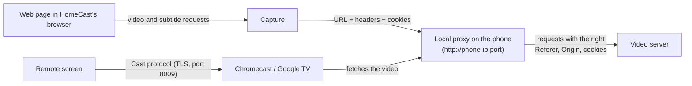

# HomeCast

Cast videos from web pages to your Chromecast or Google TV — no ads, no tracking.

HomeCast is an Android app with a built-in browser. Open a page that has a video
player, start the video, and HomeCast finds the stream and plays it on your TV.
Your phone becomes the remote control.

It is a general-purpose tool: it is not tied to any website. It talks to the TV
with its own implementation of the Cast protocol, so it does not need Google Play
Services, and it contains no ads, analytics or crash reporting.

## Features

- **Finds the video on the page** — HLS streams (`.m3u8`) and video files
  (`.mp4`, `.webm`, `.mkv`), including players inside iframes and playlists
  loaded by scripts.
- **Blocks ads and popups** — a bundled host blocklist, popups and windows that
  scripts open are dropped, and the page cannot redirect you to another site
  unless you tap. A link you tap that would open a new tab opens in the same
  page instead.
- **Plays on any Chromecast or Google TV device** (TVs and boxes with built-in
  Chromecast) using the Default Media Receiver.
- **Finds your TV automatically**, or connects by IP address. TVs you used are
  remembered; if a TV found on the network gets a new IP address, HomeCast
  looks for it and saves the new address.
- **Remote control** — play/pause, seek bar, back/forward 10 seconds, volume,
  mute and stop. The phone's volume keys change the TV volume. If the TV drops
  the video (it was closed on the TV, the connection came back, or it ended),
  **Play again on TV** sends it again from where it was.
- **The phone stays silent** — when you tap Play on TV, the video on the page
  is paused on the phone.
- **Notification and lock-screen controls**, and playback keeps going with the
  screen off. When the TV is not playing any more, HomeCast lets the phone sleep
  again and leaves a "Stopped" notification you can dismiss.
- **Subtitles** — subtitles loaded by the page's player (up to 20 per page) are
  sent to the TV, and you can add your own `.srt` file. Turkish files in Windows-1254 /
  ISO-8859-9 are converted automatically.
- **Live streams** — shown with a LIVE label instead of a seek bar.
- **Series** — go back to the browser, open the next episode, and one tap
  replaces the video on the TV.

## How it works



1. The browser watches the requests the page makes and spots the video stream
   and any subtitles.
2. When you tap **Play on TV**, HomeCast starts a small web server (a proxy) on
   the phone. The TV asks the phone for the video, and the phone fetches it from
   the original server with the headers that server expects (Referer, Origin,
   User-Agent, cookies). Without this, many servers refuse the TV.
3. HomeCast tells the TV, over the Cast protocol, to play the proxy address.

Because the video passes through your phone, **the phone has to stay on the same
Wi-Fi as the TV, and HomeCast keeps running in the background while you watch**.

## Install

HomeCast is not on the Play Store. Install it from GitHub Releases:

1. On your phone, open the
   [latest release](https://github.com/YunusErdemSihhatli/homecast/releases/latest)
   and download `HomeCast-vX.Y.Z.apk`.
2. Open the downloaded file. Android asks you to allow your browser (or file
   manager) to **install unknown apps** — allow it for that app, then go back
   and tap **Install**.
3. Updates are installed the same way, over the existing app. Every release is
   signed with the same key, so your saved TVs are kept.

Requires Android 8.0 or newer.

### Connect by IP

If your TV does not show up in the list (some routers block device discovery),
open **Choose TV** and type the TV's IP address in **Connect by IP**, for example
`192.168.1.20` (port `8009` is used unless you add `:port`). You can find the IP
address in the TV's network settings or your router's device list. HomeCast
remembers the TV. A TV you typed in by IP is always contacted at that address:
if its IP address changes, enter the new one. (A TV you picked from the list is
looked for on the network when its saved address stops answering, and its new
address is saved.)

### Samsung phones and battery optimisation

Samsung (One UI) and some other phones stop background apps aggressively, which
stops the video on the TV when the screen turns off. On first launch HomeCast
asks to be exempted from battery optimisation — please allow it. You can also
open it later from the **⋮** menu on the remote screen (**Battery
optimisation**). On Samsung, also check *Settings → Battery → Background usage
limits* and make sure HomeCast is not in *Sleeping apps* or *Deep sleeping apps*.

## Limitations

- **No DRM.** Videos protected by DRM (paid streaming services) cannot be cast.
  This is not something HomeCast tries to work around.
- **No geo-restriction bypass.** HomeCast has no VPN or proxy features; it only
  sees what your phone can already play.
- **No downloads.** HomeCast plays videos; it does not save them.
- **No DASH (`.mpd`) yet.** DASH videos are listed as "not supported".
- **Same Wi-Fi, app running.** The video goes through your phone, so the phone
  must stay on the same Wi-Fi as the TV, and HomeCast keeps running in the
  background (with a notification) while you watch.
- **Subtitles inside the HLS stream** (subtitle tracks listed in the stream's
  own playlist rather than loaded by the page) are left to the TV's player:
  they are not listed in HomeCast's subtitle menu and cannot be switched from
  the remote.
- Some sites use short-lived video links. If the TV says the server rejected
  the request, reload the page and tap Play on TV again.

## Privacy

HomeCast has no ads, analytics, crash reporting, accounts or cloud features,
and it does not use Google Play Services. It only makes network connections to:

- the pages you open (and searches you type, which go to DuckDuckGo),
- the media servers those pages use,
- your TV (Cast discovery on the local network and the Cast connection).

The settings and saved TVs stay on the phone.

**WebView Safe Browsing and WebView usage metrics are turned off on purpose**,
because both send data to Google. The trade-off: HomeCast's browser does **not**
show Google's warnings for known malicious or phishing sites. Be careful which
sites you open, and don't enter passwords or payment details in HomeCast's
browser.

### A note about the TV connection

Chromecast devices use self-signed certificates, so HomeCast cannot verify the
TV's identity and does not validate its certificate (only for that connection;
every other connection is verified normally). This is how other Cast senders
work too, but it means a device on the same network could pretend to be your TV.
**Only connect to your own TV on a network you trust**, such as your home Wi-Fi.

## Build from source

Requirements: JDK 17 or newer and the Android SDK (platform 36).

```sh
git clone https://github.com/YunusErdemSihhatli/homecast.git
cd homecast
./gradlew assembleDebug
```

The APK is written to `app/build/outputs/apk/debug/app-debug.apk`.

`./gradlew assembleRelease` builds a minified release APK. It is signed with the
key named in the `HOMECAST_KEYSTORE_FILE`, `HOMECAST_KEYSTORE_PASSWORD`,
`HOMECAST_KEY_ALIAS` and `HOMECAST_KEY_PASSWORD` environment variables, or in a
git-ignored `keystore.properties` file at the repository root (`storeFile`,
`storePassword`, `keyAlias`, `keyPassword`); each value is taken from its
environment variable first. The keystore path may be absolute or relative to the
repository root. If any value is missing, the release APK is signed with the
debug key and Gradle prints a warning naming what is missing; set
`HOMECAST_REQUIRE_RELEASE_SIGNING=true` to make the build fail instead.

The release workflow (`.github/workflows/release.yml`) only publishes an APK
whose signing certificate matches the SHA-256 digest in `HOMECAST_CERT_SHA256`.
If the signing key is ever rotated, update that value (from
`apksigner verify --print-certs`) along with the repository secrets.

See [CONTRIBUTING.md](CONTRIBUTING.md) for checks and conventions, and
[docs/TESTING.md](docs/TESTING.md) for the on-device test checklist.

## Licence

HomeCast is free software, licensed under the
[GNU General Public License v3.0](LICENSE).

## Third-party notices

- The ad blocklist is derived from [StevenBlack/hosts](https://github.com/StevenBlack/hosts)
  (MIT licence), using only its upstream lists whose licences allow
  redistribution; they are listed in the notices.
- HomeCast uses AndroidX and Jetpack Compose, Kotlin coroutines and
  kotlinx.serialization, Ktor and OkHttp (Apache License 2.0), and SLF4J (MIT).

Full notices are in [THIRD_PARTY_NOTICES.md](THIRD_PARTY_NOTICES.md).
